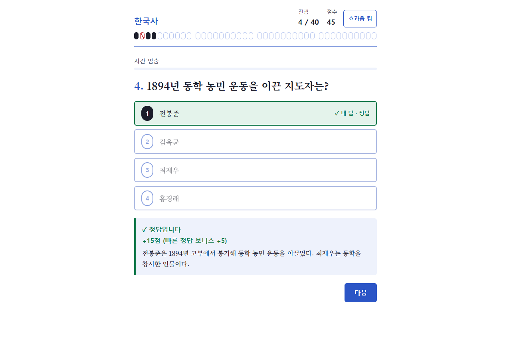
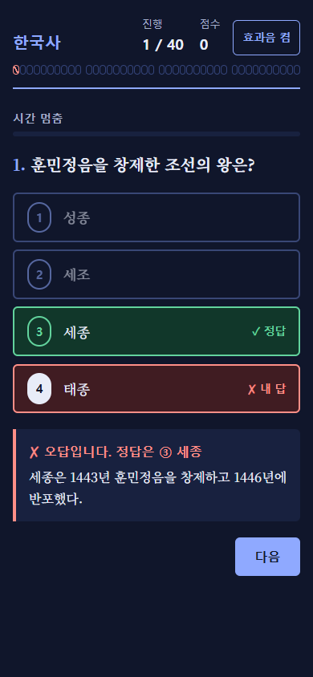
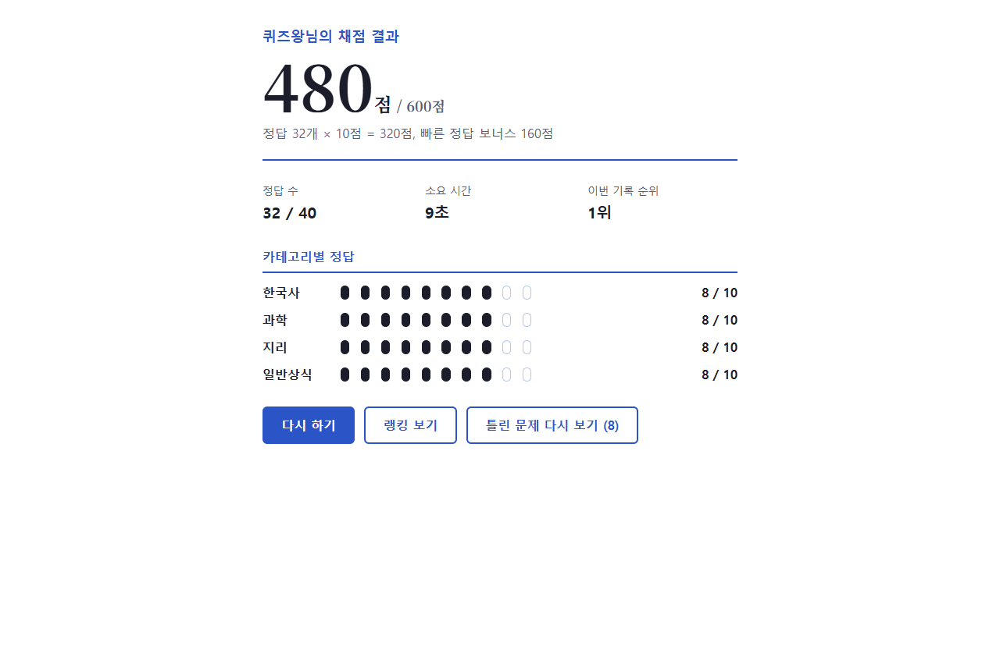

# 상식 퀴즈

한국사·과학·지리·일반상식 4개 카테고리 40문제를 4지선다로 푸는 웹 퀴즈 게임입니다.
답을 고르면 바로 정답과 해설을 보여 주고, 빨리 맞힐수록 보너스 점수를 받으며, 기록을 닉네임과 함께 랭킹에 남깁니다.
시험 답안지(OMR 카드)를 본뜬 화면으로, 모바일과 다크 모드를 지원합니다.

<p>
  
  
</p>

## 주요 기능

- **40문제 전체 도전**: 한국사 → 과학 → 지리 → 일반상식 순서로 10문제씩 나옵니다. 카테고리 안의 문제 순서와 보기 순서는 매번 무작위입니다.
- **즉시 피드백**: 보기를 누르면 바로 답이 확정되고, 정답·오답을 색과 ✓/✗ 기호로 보여 준 뒤 해설을 띄웁니다.
- **15초 제한과 빠른 정답 보너스**: 정답은 10점이고, 남은 시간 3초마다 1점(최대 5점)을 더 받습니다. 시간이 지나면 오답 처리되며 만점은 600점입니다.
- **카테고리 연습**: 한 카테고리 10문제만 풀 수 있습니다. 랭킹에는 남지 않고, 제한 시간 없이 풀 수도 있습니다.
- **결과와 오답 다시 보기**: 총점과 내역, 정답 수, 소요 시간, 카테고리별 정답 수, 이번 기록의 순위를 보여 주고 틀린 문제를 해설과 함께 다시 볼 수 있습니다.
- **랭킹**: 상위 10위를 보여 주며 닉네임마다 가장 좋은 기록 하나만 올라갑니다. 카테고리별 최고 기록 탭도 있습니다.
- **통계**: 완주율, 재도전율, 문제별 정답률을 보여 주고 너무 어렵거나 쉬운 문제를 표시합니다.
- **문제 교체**: 문제는 JSON 파일 하나에 있어 코드를 고치거나 다시 빌드하지 않고 바꿀 수 있습니다.
- **접근성**: 키보드 1~4로 보기를 고를 수 있고, 웹 접근성 기준(WCAG 2.2 AA) 자동 점검을 통과합니다. 효과음은 끌 수 있습니다.



## 기술 스택

| 구분 | 사용한 것 |
| --- | --- |
| 화면 | [React](https://react.dev/) 19, TypeScript 7 |
| 빌드·개발 서버 | [Vite](https://vite.dev/) 8 |
| 스타일 | 일반 CSS(색 토큰으로 라이트·다크 모드), 웹폰트 Noto Serif KR |
| 효과음 | Web Audio API(소리 파일 없이 브라우저에서 합성) |
| 저장 | 브라우저 `localStorage` (서버 없음) |
| 테스트 | [Vitest](https://vitest.dev/) 5, Testing Library, jsdom |
| 브라우저 점검 | [Playwright](https://playwright.dev/), axe-core(접근성) |
| 코드 검사 | [oxlint](https://oxc.rs/) |

외부 상태 관리 라이브러리나 라우터는 쓰지 않습니다. 게임 규칙은 모두 React와 무관한 순수 함수(`src/game`)에 있습니다.

## 설치 및 시작

[Node.js](https://nodejs.org/) 22.12 이상이 설치되어 있다면 아래 세 줄로 바로 실행할 수 있습니다.

```bash
git clone https://github.com/jangsooho1016-prog/quiz-game.git
cd quiz-game
npm install && npm run dev
```

브라우저에서 <http://localhost:5173> 을 열면 시작 화면이 나옵니다.

## 설치 방법

### 1. 준비물

- **Node.js 22.12 이상** (npm 포함). 버전은 `node -v`로 확인합니다.
- **Git**
- 브라우저 점검(`npm run test:e2e`)까지 돌리려면 **Google Chrome**

### 2. 내려받기와 의존성 설치

```bash
git clone https://github.com/jangsooho1016-prog/quiz-game.git
cd quiz-game
npm install
```

### 3. 실행

```bash
npm run dev       # 개발 서버 (http://localhost:5173)
```

### 4. 배포용 빌드

```bash
npm run build        # 타입 검사 후 dist/ 폴더에 결과물 생성
npm run preview      # 빌드 결과를 로컬에서 미리 보기
npm run build:pages  # GitHub Pages용 (주소가 /quiz-game/ 로 시작하도록 빌드)
```

`dist/` 폴더는 정적 파일뿐이라 GitHub Pages, Netlify, Vercel 같은 정적 호스팅에 그대로 올릴 수 있습니다.
GitHub Pages처럼 하위 경로(`https://jangsooho1016-prog.github.io/quiz-game/`)에 올릴 때는 `npm run build:pages`로 빌드하세요. 파일 주소가 `/quiz-game/` 아래로 맞춰집니다.

### 5. 테스트

| 명령 | 하는 일 |
| --- | --- |
| `npm run test` | 단위·화면 테스트 (Vitest) |
| `npx vitest run src/game/ranking.test.ts -t "점수가 같으면"` | 파일 하나, 테스트 하나만 실행 |
| `npm run test:e2e` | 실제 브라우저 점검 (Playwright): 한 판 플레이, 시간 초과, 접근성, 360px 모바일 배치 |
| `npm run lint` | 코드 검사 (oxlint) |

`npm run test:e2e`는 설치된 Google Chrome을 씁니다. Chrome이 없으면 `npx playwright install chromium`으로 내려받은 뒤 `PW_CHANNEL=chromium npm run test:e2e`로 실행하세요.

## 사용법

### 게임하기

1. 시작 화면에서 **닉네임**(2~10자, 띄어쓰기 없이)을 입력합니다.
2. **게임 방식**을 고릅니다.
   - **전체 도전**: 40문제, 끝까지 풀면 랭킹에 기록됩니다.
   - **카테고리 연습**: 카테고리 하나를 골라 10문제를 풉니다. "제한 시간 없이 풀기"를 켤 수 있습니다(보너스 없음).
3. **시작하기**를 누르고 보기를 클릭하거나 키보드 **1~4**를 누릅니다. 답은 누르는 즉시 확정되어 바꿀 수 없습니다.
4. 정답과 해설을 확인한 뒤 **다음**을 누릅니다. 마지막 문제 뒤에는 **결과 보기**가 나옵니다.
5. 결과 화면에서 **틀린 문제 다시 보기**, **다시 하기**, **랭킹 보기**를 고를 수 있습니다.
6. 랭킹 화면의 탭으로 카테고리별 최고 기록을, **통계 보기**로 완주율·재도전율·문제별 정답률을 볼 수 있습니다.

점수가 같으면 더 빨리 끝낸 사람이, 시간도 같으면 먼저 기록한 사람이 높은 순위가 됩니다.
상단의 **효과음** 버튼으로 소리를 켜고 끌 수 있으며 설정은 기억됩니다.

### 문제 바꾸기

문제는 [`public/questions.json`](public/questions.json)에 있고 앱이 시작할 때 불러옵니다.
배포된 사이트에서도 `dist/questions.json`만 바꾸면 다시 빌드하지 않아도 문제가 바뀝니다.

```json
{
  "id": 1,
  "category": "한국사",
  "content": "훈민정음을 창제한 조선의 왕은?",
  "options": ["세종", "태종", "세조", "성종"],
  "answer": 1,
  "explanation": "세종은 1443년 훈민정음을 창제하고 1446년에 반포했다."
}
```

- `category`는 `한국사`, `과학`, `지리`, `일반상식` 중 하나이고, `answer`는 정답 보기 번호(1~4)입니다.
- 카테고리마다 10문제 이상 있어야 합니다. 10문제보다 많으면 판마다 무작위로 10문제를 뽑습니다.
- 형식이 틀리면 시작 화면에 몇 번 항목이 왜 틀렸는지 표시되고 게임을 시작할 수 없습니다.
- 지운 문제의 `id`를 다른 문제에 다시 쓰지 마세요. 예전 판의 답안 기록이 그 `id`를 가리킵니다.
- 문제를 고친 뒤에는 `npm run test`로 형식을 확인하고, [`docs/question-review.md`](docs/question-review.md)로 두 사람이 교차 검수합니다.

### 저장 데이터

서버 없이 브라우저 `localStorage`에만 저장하므로 랭킹과 통계는 브라우저마다 따로입니다.
기록을 지우려면 브라우저 개발자 도구에서 이 사이트의 저장소를 비우세요.

| 키 | 내용 |
| --- | --- |
| `quiz-game/v2/records` | 끝낸 전체 도전 기록 (랭킹) |
| `quiz-game/v2/answer-logs` | 기록별 문제 답안 (오답 다시 보기, 점수 검증) |
| `quiz-game/v2/plays` | 시작·종료·다시 하기 기록 (통계) |
| `quiz-game/sound` | 효과음 켜기/끄기 |

### 폴더 구조

```
public/questions.json   문제 은행 (실행 중에 불러옴)
src/game/               게임 규칙 순수 함수: 출제, 채점, 보너스, 순위, 진행 상태, 통계
src/storage/            저장소 인터페이스와 localStorage 구현
src/data/               문제 파일 불러오기와 형식 검사
src/screens/            화면 (시작, 퀴즈, 결과, 오답, 랭킹, 통계)
src/components/         공용 화면 조각
src/sound/              효과음과 설정
e2e/                    Playwright 브라우저 점검
docs/                   기획서(PRD), 남은 일 체크리스트, 문제 검수표
```

기획서는 [`docs/prd.md`](docs/prd.md), 결정 사항과 남은 일은 [`docs/remaining-checklist.txt`](docs/remaining-checklist.txt)에 있습니다.

## 라이선스

[MIT License](LICENSE) © 2026 jangsooho1016-prog

누구나 이 코드를 쓰고, 고치고, 배포할 수 있습니다. 다만 저작권 표시와 라이선스 문구를 함께 남겨야 합니다.
